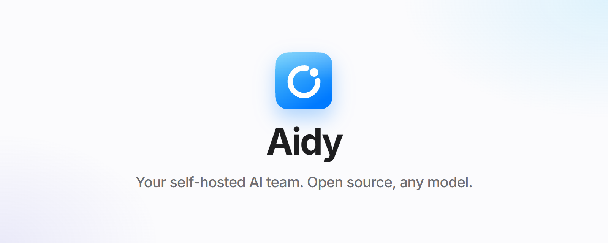

<p align="center">
  
</p>

<h1 align="center">Aidy</h1>

<p align="center">
  <strong>Your self-hosted AI team.</strong> Always-on agents that do the work, remember how you like it, and reach you on WhatsApp.<br />
  Open source · Any model · Plugin-first · MCP-native · MIT licensed
</p>

<p align="center">
  <a href="https://aidyagent.app"><strong>aidyagent.app</strong></a> ·
  <a href="https://aidyagent.app/docs">Docs</a> ·
  <a href="https://github.com/imzodev/aidy/releases/latest">Desktop app</a>
</p>

<p align="center">
  <a href="https://github.com/imzodev/aidy/blob/main/LICENSE"></a>
  <a href="https://github.com/imzodev/aidy/stargazers"></a>
  <a href="https://github.com/imzodev/aidy/issues"></a>
  <a href="https://github.com/imzodev/aidy/network/members"></a>
  <a href="https://github.com/imzodev/aidy/commits/main"></a>
  <a href="https://www.npmjs.com/package/@aidyagent/app"></a>
</p>

---

## Why Aidy?

Most agent tooling today falls into one of three traps:

- **Chat-only platforms** that are great at single conversations but can't run real automation, scheduled work, or multi-channel workflows.
- **Workflow engines** (n8n, Zapier-style) that automate anything but treat the LLM as just another node — no first-class agent runtime, no real-time streaming.
- **Multi-agent frameworks** (CrewAI, AutoGen-style) that ship great orchestration primitives but ship no platform — no UI, no persistence, no auth, no channels, no scheduler.

**Aidy is the fourth option**: an open source, self-hostable AI agent platform that combines all three.

You get persistent sessions with token-by-token streaming, a real cron and event scheduler, plugin-based channels (WhatsApp today; Telegram, Discord, Slack next), MCP as a first-class interoperability layer, and a SolidJS operator UI — all from one command.

## Quick start

The fastest way to run Aidy — no git clone, no build step. The installer provisions a managed Node.js 22 runtime (only if your system Node is too old for `node:sqlite`), installs ripgrep, pulls the prebuilt `@aidyagent/app` from npm, generates a bootstrap admin token, and opens your browser to the login screen with the token pre-filled.

**macOS / Linux / WSL:**

```bash
curl -fsSL https://aidyagent.app/install.sh | bash
```

**Windows (PowerShell):**

```powershell
iex (irm https://aidyagent.app/install.ps1)
```

Then you have a clean, tiny CLI:

```bash
aidy start    # boot the server + UI on http://localhost:3001
aidy stop     # shut it down
aidy status   # check whether it's running
aidy init     # regenerate the bootstrap admin token if needed
```

**Running on a Linux server?** Let systemd keep it up: it starts at boot and restarts within seconds after a crash. `start`/`stop`/`restart` keep working and go through systemd.

```bash
aidy service install
```

**Moving servers?** **System → Backups** in the UI exports your database, config, workspaces, skills and addons to one zip and restores it on the new machine. It streams to disk, so multi-GB backups work even on a 1 GB droplet. See [docs/backups.md](docs/backups.md).

**For contributors** — building from source:

```bash
git clone https://github.com/imzodev/aidy.git && cd aidy
pnpm install && pnpm dev
# → API at http://localhost:3001, UI at http://localhost:5173
```

The dev mode runs the API server and Vite UI separately with hot reload.

**Prefer a native app?** Download a Windows/macOS/Linux installer from the
[Releases page](https://github.com/imzodev/aidy/releases/latest) — see
[docs/desktop/INSTALL.md](docs/desktop/INSTALL.md) for setup notes.

## Who is this for?

✅ **You're a good fit if you want to:**

- Self-host an AI agent runtime with a real UI (no SaaS dependency, no vendor lock-in).
- Run agents on a schedule, react to events, or trigger them from messaging channels.
- Stream tokens live to an operator dashboard while keeping full transcripts on disk.
- Extend a small, stable core with your own tools, channels, providers, and UI panels — without forking.
- Plug into the MCP ecosystem on either side (consume MCP servers **and** expose your platform as one).

❌ **Aidy is probably not for you if you:**

- Just want a chat UI to talk to one model — use OpenAI's playground, Claude.ai, or ChatGPT.
- Need a no-code visual workflow builder with hundreds of pre-built integrations — use n8n or Zapier.
- Are building a research-only multi-agent experiment and don't care about persistence, auth, or a UI — CrewAI or AutoGen may be lighter.
- Want a managed cloud product — Aidy is self-hosted by design.

## How Aidy compares

| Capability                                            | Aidy | n8n | CrewAI | AutoGen |
| ----------------------------------------------------- | :--: | :-: | :----: | :-----: |
| **Self-hostable**                                     |  ✅  | ✅  |   ❌   |   ❌    |
| **Built-in operator UI**                              |  ✅  | ✅  |   ❌   |   ❌    |
| **Real-time token streaming**                         |  ✅  | 🟡  |   ❌   |   ❌    |
| **Persistent agent sessions**                         |  ✅  | 🟡  |   ❌   |   ❌    |
| **Cron + one-shot scheduler**                         |  ✅  | ✅  |   ❌   |   ❌    |
| **First-class MCP support**                           |  ✅  | 🟡  |   ❌   |   ✅    |
| **Plugin SDK (tools, channels, UI)**                  |  ✅  | ✅  |   ❌   |   ❌    |
| **Messaging channels (WhatsApp, etc.)**               |  ✅  | ✅  |   ❌   |   ❌    |
| **Multi-agent orchestration**                         |  ✅  | 🟡  |   ✅   |   ✅    |
| **Provider-agnostic (OpenAI/Anthropic/Gemini/local)** |  ✅  | ✅  |   ✅   |   ✅    |
| **License**                                           | MIT  | ⚖️  |  MIT   |   MIT   |

Legend: ✅ yes &nbsp;&nbsp; 🟡 partial &nbsp;&nbsp; ❌ no &nbsp;&nbsp; ⚖️ "Sustainable Use" (not OSI-open)

This is an honest comparison, not a sales pitch. Choose the tool that fits the job.

## What it does

- Run AI agents in persistent sessions with real-time token streaming
- Schedule and automate agent work with cron and one-shot jobs
- Connect agents to messaging channels (WhatsApp ships today; Telegram, Discord, Slack planned)
- Manage trusted devices and runtime instances through a pairing system
- Back up everything to one zip and restore it on another server, from the UI
- Extend the platform with plugins: custom tools, UI panels, channels, integrations
- Connect to any MCP server, and expose selected platform capabilities back through MCP

## Repository layout

```
aidy/
  apps/
    server/       # Fastify REST + WebSocket API
    web/          # SolidJS operator UI
  packages/
    cli/          # CLI tooling
    config/       # Config schema and loaders
    db/           # Drizzle ORM schema, migrations, repositories
    runtime/      # Agent runtime and provider abstraction
    sdk/          # Public client SDK
    plugin-sdk/   # Public plugin registration API
    ui-sdk/       # Public UI panel contracts
    shared-types/ # Shared TypeScript contracts (DTOs, events, IDs)
  config/
    skills/       # Bundled default skills seeded on first run
  docs/           # User-facing documentation
  plans/          # Internal design docs and implementation plans
  plugins/        # First-party and example plugins
  landing/        # Public marketing site (Vite + React)
```

## Prerequisites (for building from source)

The installer takes care of Node.js and ripgrep for you. If you want to develop or self-host from a source checkout, install these manually:

- [Node.js](https://nodejs.org) v22.13+ (or v24+) — required for Node's built-in `node:sqlite`
- [pnpm](https://pnpm.io) v10+
- [ripgrep](https://github.com/BurntSushi/ripgrep) — required by `code_search` / `code_glob` tools
- PostgreSQL (optional — SQLite is used by default)

## Setup from source

1. **Clone the repository**

   ```bash
   git clone https://github.com/imzodev/aidy.git
   cd aidy
   ```

2. **Install dependencies**

   ```bash
   pnpm install
   ```

3. **Configure environment variables**

   Copy the example env file and fill in your values:

   ```bash
   cp .env.example .env
   ```

   Key variables:

   | Variable          | Default                   | Description                              |
   | ----------------- | ------------------------- | ---------------------------------------- |
   | `PORT`            | `3001`                    | HTTP server port                         |
   | `CORS_ORIGIN`     | `http://localhost:5173`   | Allowed CORS origin                      |
   | `DB_KIND`         | `sqlite`                  | Database backend: `sqlite` or `postgres` |
   | `DATABASE_URL`    | —                         | Required when `DB_KIND=postgres`         |
   | `SQLITE_PATH`     | `./data/aidy.db`          | SQLite file path                         |
   | `AIDY_HOME`       | `.aidy/`                  | Base directory for user data             |
   | `WS_TOKEN_SECRET` | `change-me-in-production` | **Change this in production**            |

4. **Run the development server**

   ```bash
   pnpm dev
   ```

   This starts both the API server (`http://localhost:3001`) and the web UI (`http://localhost:5173`) in parallel with hot reload.

   To run them separately:

   ```bash
   pnpm dev:server   # API only
   pnpm dev:web      # UI only
   ```

## Available scripts

| Command           | Description                       |
| ----------------- | --------------------------------- |
| `pnpm dev`        | Start server + web UI in parallel |
| `pnpm dev:server` | Start API server only             |
| `pnpm dev:web`    | Start web UI only                 |
| `pnpm build`      | Build all packages and apps       |
| `pnpm test`       | Run all tests                     |
| `pnpm lint`       | Lint all packages                 |
| `pnpm format`     | Format all files with Prettier    |

## Providers

Aidy talks to LLMs through a pluggable `Provider` abstraction. Configure providers through the UI (Settings → Providers) or via the config file. Presets ship in `packages/shared-types/src/providers-preset.ts`:

| Provider      | Type               | Auth                                    |
| ------------- | ------------------ | --------------------------------------- |
| OpenAI        | OpenAI-compatible  | API key                                 |
| Anthropic     | Anthropic          | API key                                 |
| Google Gemini | Gemini             | API key                                 |
| Groq          | OpenAI-compatible  | API key                                 |
| DeepSeek      | OpenAI-compatible  | API key                                 |
| MiniMax       | OpenAI-compatible  | API key                                 |
| OpenCode Go   | OpenAI / Anthropic | API key                                 |
| Ollama        | OpenAI-compatible  | **none — local** (`localhost:11434/v1`) |
| LM Studio     | OpenAI-compatible  | **none — local** (`localhost:1234/v1`)  |

### Local providers (Ollama, LM Studio)

Local providers expose an OpenAI-compatible endpoint on `localhost` and ignore the `Authorization` header. Aidy's UI:

- Skips the credential dialog when you pick a local preset card.
- Auto-discovers installed/loaded models by probing `{baseUrl}/models` (click **Discover models** in the provider modal).
- Sends a placeholder `Bearer` header that the local server ignores.

Before configuring, make sure the local server is running and has at least one model loaded:

```bash
# Ollama — https://ollama.com
ollama serve                # default port 11434
ollama pull llama3.2        # pull a model into the local store

# LM Studio — https://lmstudio.ai
# Start the local server from the LM Studio "Developer" tab (default port 1234).
```

Then in Aidy: **Settings → Providers → Ollama (or LM Studio) → Discover models → Save**.

If you run a local server on a non-default port or behind a tunnel, use **Add Custom** with `vendorFamily: openai-compatible` and your full base URL (e.g. `http://localhost:11435/v1`).

### Custom providers

Any OpenAI-compatible, Anthropic, or Gemini endpoint can be added through the **Add Custom** dialog in Settings → Providers. Provide a unique ID, display name, base URL, and (optionally) the name of an env var holding the API key.

## Skills

Skills are reusable system-prompt instructions attached to agents. Bundled skills from `config/skills/` are automatically seeded to `AIDY_HOME/skills/` on server startup.

**Update policy:**

- If you have not modified a skill, app updates will propagate automatically when a newer version ships.
- If you have modified a skill locally, your changes are always preserved regardless of app updates.

To create a custom skill, add a directory under `AIDY_HOME/skills/` with a `SKILL.md` file:

```
.aidy/skills/my-skill/SKILL.md
```

```markdown
---
name: My Skill
description: What this skill does
version: 1.0.0
---

Your skill instructions here.
```

## MCP integration

Aidy connects to external MCP servers via stdio or HTTP transport. Configure servers through the UI or the REST API at `POST /api/mcp/servers`.

### Preinstalled servers

The following MCP servers ship preinstalled (reconciled into every install on startup from `config/aidy.template.json`):

| Server              | Transport | Auth                              | Notes                                                                                                                                   |
| ------------------- | --------- | --------------------------------- | --------------------------------------------------------------------------------------------------------------------------------------- |
| GitHub              | http      | `${GITHUB_PERSONAL_ACCESS_TOKEN}` | [PAT](https://github.com/settings/tokens) with `repo` + `read:user` scopes                                                              |
| Sequential Thinking | stdio     | none                              | step-by-step reasoning                                                                                                                  |
| Time                | stdio     | none                              | time + timezone conversion (`@guanxiong/mcp-server-time`)                                                                               |
| Playwright Browser  | stdio     | none                              | Microsoft-maintained browser automation                                                                                                 |
| Context7 Docs       | http      | optional                          | [free tier](https://context7.com/dashboard) works without a key; higher rate limits with `${CONTEXT7_API_KEY}`                          |
| Brave Search        | stdio     | `${BRAVE_API_KEY}`                | [free tier](https://brave.com/search/api/) (~2000 req/month)                                                                            |
| Tavily Search       | stdio     | `${TAVILY_API_KEY}`               | [free tier](https://tavily.com/)                                                                                                        |
| Buffer              | http      | `${BUFFER_API_KEY}`               | [Buffer](https://buffer.com) social media scheduling — per-account API key                                                              |
| Supabase            | http      | `${SUPABASE_ACCESS_TOKEN}`        | [personal access token](https://supabase.com/dashboard/account/tokens) — database, docs, functions, branching                           |
| Notion              | stdio     | `${NOTION_TOKEN}`                 | [internal integration](https://www.notion.so/my-integrations) token — share pages/databases with it from each page's "Connections" menu |

#### Setting API keys

Servers that require a secret reference it as `${VAR_NAME}` in `headers` (http) or `env` (stdio). Two ways to satisfy:

1. **Set the env var before starting the server** — recommended. Secrets stay out of the config file:
   ```bash
   export GITHUB_PERSONAL_ACCESS_TOKEN=ghp_…
   export BRAVE_API_KEY=…
   aidy start
   ```
2. **Edit the server via the UI** (`MCP` page → Edit) and replace `${VAR}` with the literal key. This persists the key in `~/.aidy/config.json` — convenient but less secure.

A server whose `${VAR}` is unset sits in "Awaiting configuration" instead of trying (and failing) to connect — set the env var or paste the key to activate it.

#### Adding or removing preinstalled servers

Edit `config/aidy.template.json` and add/remove entries. On the next server start, `apps/server/src/mcp/preinstall.ts` reconciles: new entries are added, updated entries replace pristine ones, and servers the user has deleted are not resurrected. User-edited entries are never clobbered.

## Documentation

See [`docs/`](./docs/) for the full user-facing documentation — [Getting Started](./docs/getting-started.md), Agents, Sessions, Tasks, Channels, MCP servers, Providers, Addons, and more, starting from [`docs/index.md`](./docs/index.md). The [CLI reference](./docs/cli/command-reference.md) lives there too.

## Contributing

1. Create a feature branch from `main`
2. Make your changes — keep commits focused
3. Run `pnpm lint && pnpm test` before pushing
4. Open a pull request

**Code conventions:**

- Types go in `packages/shared-types` (shared) or `src/types.ts` (server-internal) — never exported from logic files
- All route handlers live in `apps/server/src/routes/`
- Each package exposes a public API through its `src/index.ts`

Internal design docs, architecture decisions, and in-progress implementation plans live in [`plans/`](./plans/) — start at [`plans/overview.md`](./plans/overview.md) or [`plans/architecture.md`](./plans/architecture.md).

## License

[MIT](./LICENSE) — do-it-yourself, for real.
